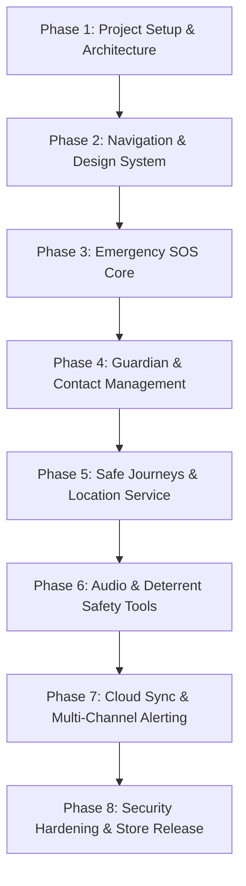

# SafeHer-Next — Comprehensive Project Plan

## Executive Summary
**SafeHer-Next** is an enterprise-grade, privacy-first personal safety application engineered for Android. The application is built incrementally in distinct, testable phases to ensure maximum stability, zero architectural regressions, and production readiness.

---

## Roadmap Overview

---

## Detailed Phase Breakdown

### Phase 1: Fresh Project Setup & Foundation (Current Phase)
- [x] Clean directory and Gradle Kotlin DSL setup (`.gradle.kts`).
- [x] Android Gradle Plugin, Kotlin 2.x, and Jetpack Compose toolchain integration.
- [x] Gradle Version Catalog (`gradle/libs.versions.toml`).
- [x] Standard Gradle Wrapper (v9.6+) and offline build configuration.
- [x] Design token foundation: Lavender `#F8F6FD`, Purple `#7C3AED`, Pink `#EC4899`, White cards.
- [x] Base MVVM scaffolding with `MainActivity`, `WelcomeScreen`, and `WelcomeViewModel`.
- [x] Security and Project documentation (`README.md`, `PROJECT_PLAN.md`, `SECURITY_AND_PRIVACY.md`).
- **Phase Boundary:** No live sensors, no contacts, no SOS triggers.

---

### Phase 2: Design System & Core Navigation Shell
- **Scope:** 
  - Complete Material 3 component library (custom buttons, floating action emergency bar, pulse badges).
  - Navigation Component with Compose Navigation (`androidx.navigation:navigation-compose`).
  - Core scaffold with Bottom Navigation:
    - *Home* (Quick safety status & SOS trigger)
    - *Journeys* (Active trip tracking & ETA check-ins)
    - *Guardians* (Emergency circle)
    - *Safety Tools* (Siren, fake call, resource hotline)
    - *Settings* (Privacy settings, hardware triggers)
- **Deliverables:** Interactive navigational shell with mock states and strict edge-to-edge support.

---

### Phase 3: Emergency SOS Core & Hardware Triggers
- **Scope:**
  - One-tap SOS button with animated 3-second abort countdown (to prevent accidental triggers).
  - Hardware triggers: Rapid power button click detection (via accessibility/broadcast) and shake detection (accelerometer).
  - Direct offline SMS dispatching with GPS coordinates to pre-selected emergency contacts.
  - Emergency dialing shortcut integration (112 / 911 / local emergency dispatcher).
- **Safety Boundary:** All SOS logic must work without an active internet connection.

---

### Phase 4: Guardian & Contact Management (Implemented)
- **Status:** Complete (Local-first Room architecture)
- **Scope & Implementation:**
  - Local SQLite database managed via Android Room (`safeher_guardians.db`) with `GuardianEntity`, `GuardianDao`, and singleton `SafeHerDatabase`.
  - Repository layer (`GuardianRepositoryImpl`) with reactive `Flow` emissions (`getGuardiansFlow()`, `getGuardianCountFlow()`) and coroutine-safe CRUD operations.
  - Full CRUD operations: Add new guardian, View circle list, Edit existing guardian, and Delete with explicit confirmation dialog.
  - System Contact Picker integration via `ActivityResultContracts.PickContact()` (retrieves single selected contact phone data without requesting broad `READ_CONTACTS` runtime permission).
  - Phone normalization (preserves leading `+`, strips formatting characters) and strict duplicate phone number policy enforcement.
  - Unsaved changes confirmation dialog to prevent accidental data loss in Add/Edit form.
  - Real-time Home Screen integration: `SafetyHeroBanner` dynamically updates guardian counts ("0 Guardians Added", "1 Guardian Added", "$count Guardians Added") and "Trusted Contacts" quick shortcut routes directly to the Contacts tab.
- **Phase 4.1 Enhancements (Device Contact Import & International Phone Support):**
  - **Native Contact Import Fix:** Fixed `SecurityException` / empty cursor issue by scoping ContentResolver queries to `Uri.withAppendedPath(contactUri, ContactsContract.Contacts.Data.CONTENT_DIRECTORY)`. Safely extracts display name, phone numbers, and localized labels (Mobile, Home, Work) under temporary URI permission grants without requesting broad `READ_CONTACTS`.
  - **Multiple Numbers Selection:** If a contact has multiple numbers, presents a modal selection dialog with type badges; single numbers populate immediately; contacts without numbers retain display name and prompt manual entry without auto-saving.
  - **Google libphonenumber Integration:** Integrated `com.googlecode.libphonenumber:libphonenumber:8.13.55` for carrier-grade parsing, E.164 canonical normalization, and international validation.
  - **Country & Dialing-Code Selector:** Searchable country selector supporting India (+91), US (+1), UK (+44), Canada (+1), Australia (+61), UAE (+971), Singapore (+65), and global regions with flag identifiers and country-specific placeholders.
  - **Double-Prefix Prevention & Paste Handling:** Intelligently detects pasted international numbers, switches country accordingly, and eliminates duplicate prefixes (e.g. preventing `+9191...`).
  - **Cross-Format Duplicate Detection:** Uses canonical E.164 for duplicate detection across equivalent formatting (`9876543210` == `+91 98765 43210`).
  - **Accessibility & Narrow Screens:** Added accessibility semantics for country selector, phone input, import button, and multiple numbers dialog; supported vertical scrolling on small screens.
- **Privacy & Storage Boundaries:**
  - **Storage:** Local Room database stored strictly in the app-private internal sandbox (`/data/user/0/com.safeher.app/databases/safeher_guardians.db`).
  - **Actual Security Properties:** Protected by Android Linux user ID (UID) sandboxing and file-system permissions. Repository abstraction is isolated to allow seamless migration to SQLCipher / Encrypted Room in Phase 8 without modifying UI or business logic.
  - **Network & Telemetry:** Absolutely zero network transmission, contact uploads, analytics, or background sync.
  - **Communications:** Zero SMS messages dispatched; zero phone calls triggered.
- **Verification Limitations:**
  - Newly added guardians default to unverified (`isVerified = false`).
  - Tapping an unverified guardian displays an honest informative dialog explaining that automated SMS/carrier verification is planned for Phase 7. Verification is never fabricated or simulated.
- **Permissions Used:**
  - No new permissions requested. System contact picker uses platform intent delegation with temporary read access for the single chosen contact.
- **Remaining Future Phase Scope:**
  - Phase 5: Safe Journeys & Background Location Tracking.
  - Phase 6: Deterrent Safety Tools (siren, fake call, evidence recorder).
  - Phase 7: Real SMS emergency dispatch, carrier verification flow, and cloud multi-channel alerting.
  - Phase 8: SQLCipher encrypted database migration and biometric locking.

---

### Phase 5: Safe Journeys & Background Location Tracking
- **Scope:**
  - Google Fused Location Provider API integration.
  - Foreground service with persistent notification and wakelock management.
  - Journey setup: Destination, estimated travel time, safety check-in countdown.
  - Missed check-in escalation: Automatic alert sent to guardians if user does not confirm arrival.
  - Battery optimization: Adaptive location polling rates (high frequency when moving, passive when stationary).

---

### Phase 6: Deterrent Safety Tools & Evidence Gathering
- **Scope:**
  - High-decibel audible deterrent siren with flashing strobe light.
  - Realistic Incoming Fake Call generator (customizable caller name, realistic ringtone and speech script).
  - Discreet background audio recorder: Activated upon SOS trigger, encrypted on-device for evidence preservation.

---

### Phase 7: Cloud Synchronization & Multi-Channel Alerting
- **Scope:**
  - End-to-end encrypted backend synchronization for live location sharing via dynamic web links.
  - Push notification relay via Firebase Cloud Messaging (FCM).
  - Fallback queue: Attempts network upload first; defaults to SMS/MMS when data connectivity fails.

---

### Phase 8: Hardening, Accessibility, QA & Store Readiness
- **Scope:**
  - Biometric authentication (Fingerprint / Face Unlock) to open sensitive journey histories or cancel an active SOS.
  - Camouflage mode: Disguise app icon and launcher screen as a calculator or note app.
  - TalkBack accessibility audit and dynamic font scaling compliance.
  - ProGuard/R8 rules optimization and release signing configuration.

---

## Quality Gate Checklist

| Criteria | Target |
| :--- | :--- |
| **Unit Test Coverage** | ≥ 80% on ViewModels & Repositories |
| **Cold Startup Time** | < 800ms on mid-tier Android devices |
| **Memory Footprint** | < 90MB during active location tracking |
| **Zero Crash Guarantee** | No unhandled exceptions during SOS triggering |
