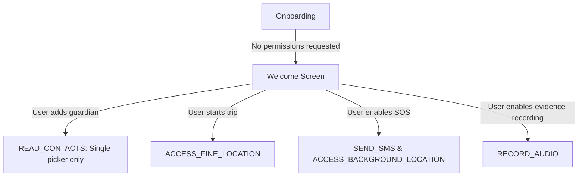

# SafeHer-Next — Security & Privacy Architecture

## 1. Core Principles

Because SafeHer is designed to protect vulnerable individuals, **user safety and privacy are treated as paramount engineering requirements**, not secondary features:

1. **Zero Unnecessary Data Collection:** We collect only the minimum data required to protect the user during an active emergency or journey.
2. **Local-First & Offline-Capable:** No life-saving feature should ever fail because mobile data, Wi-Fi, or remote servers are unreachable.
3. **End-to-End Encryption (E2EE):** All emergency telemetry (live locations, audio recordings) transmitted to guardians must be encrypted such that only designated recipients can decrypt it.
4. **Transparent Consent:** Permissions are requested strictly just-in-time with clear contextual explanations.
5. **Anti-Coercion Protections:** The system accounts for scenarios where an assailant forces the user to unlock or disable the app.

---

## 2. Threat Modeling

SafeHer mitigates threats across several distinct attack vectors:

| Threat Actor / Scenario | Risk | Mitigation |
| :--- | :--- | :--- |
| **Physical Assailant / Intimidation** | Forcing the user to cancel an SOS alert or unlock device | Duress PIN that visually pretends to cancel the SOS while quietly continuing silent tracking and dispatching a duress flag to guardians. |
| **Partner / Stalkerware Surreptitious Access** | Inspecting the victim's phone for safety apps | Camouflage launcher icon and name disguising SafeHer as a utility (e.g., "Calculator" or "Notes"). |
| **Network Interception / Public Wi-Fi** | Eavesdropping on location packets | TLS 1.3 with Certificate Pinning for all HTTPS/WSS communication. |
| **Data Breach at Rest** | Stolen device or forensic extraction of contacts & journey history | AES-256 GCM encryption via Android Keystore; SQLCipher database encryption for local records. |
| **Connectivity Denial** | Cellular data disabled or weak signal | Automatic multi-hop fallback: Web API $\rightarrow$ Direct SMS dispatch $\rightarrow$ Cellular emergency dialer. |

---

## 3. Permissions Strategy & Least Privilege

SafeHer strictly minimizes runtime permissions and never requests them upfront during onboarding:

### Specific Permission Handling
- **`ACCESS_FINE_LOCATION` & `ACCESS_BACKGROUND_LOCATION`:**
  - Requested strictly when starting a Safe Journey or enabling SOS.
  - Accompanied by a persistent Foreground Service Notification clearly displaying that active location monitoring is running.
- **`SEND_SMS`:**
  - Used strictly as an offline emergency fallback when data networks fail during an SOS broadcast.
- **`RECORD_AUDIO`:**
  - Never activated in the background passively. Activated solely when the user triggers an explicit emergency SOS to preserve evidentiary context.
- **`POST_NOTIFICATIONS`:**
  - Essential on Android 13+ (API 33+) to keep the foreground service alive and provide visible cancel/check-in controls.

---

## 4. Encryption & Key Management

### At Rest
- **Database:** SQLite database protected by Room + SQLCipher.
- **Preferences:** Sensitive keys (tokens, guardian contacts, duress pins) stored using `EncryptedSharedPreferences` / Jetpack DataStore encrypted with keys backed by the hardware **Android Keystore** (TEE / StrongBox).

### In Transit
- All network interactions enforce **TLS 1.3**.
- Direct SMS coordinates use compact encoding to prevent accidental leakage in notification preview bars if the guardian's screen is locked.

---

## 5. Anti-Coercion & Duress Protocol

In domestic abuse or violent scenarios, an attacker may demand that the victim open their phone and cancel an active SOS:

1. **Standard PIN:** Confirms user safety and broadcasts a "False Alarm / Resolved" status to guardians.
2. **Duress PIN:** 
   - Displays a completely convincing "Emergency Alert Cancelled" confirmation screen.
   - Quietly marks the server and SMS dispatch with an unacknowledged duress token (`duress=true`).
   - Keeps silent GPS streaming active without visual indicators on the device.

---

## 6. Telemetry & Analytics Policy

- **No Third-Party Ad Trackers:** Facebook SDK, Google AdMob, Adjust, or AppsFlyer are strictly forbidden in this repository.
- **Crash Reporting:** Crashlytics / Sentry configured to sanitize all PII (phone numbers, latitude/longitude, contact names, IP addresses) prior to ingestion.
- **No Location Monetization:** Location data is never stored long-term on servers and is purged within 24 hours of journey completion.
